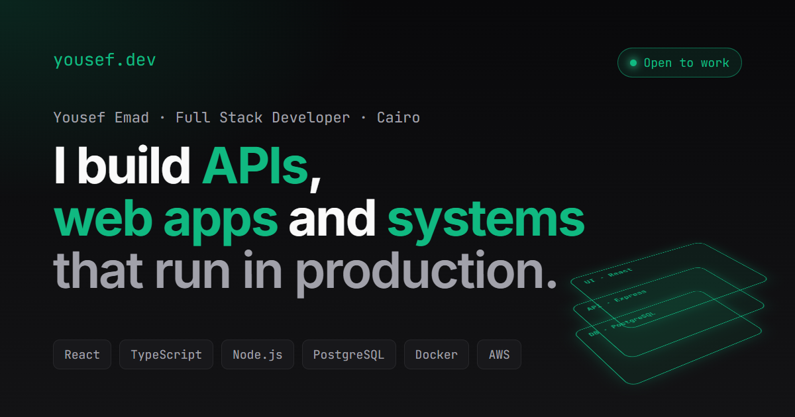

# yousef.dev

[](https://github.com/y0emad/Portfolio/actions/workflows/ci.yml)
[](https://yousef-dev.duckdns.org)

**Live:** https://yousef-dev.duckdns.org · [Status](https://yousef-dev.duckdns.org/status) ·
[API explorer](https://yousef-dev.duckdns.org/api-explorer)



My portfolio. Every page is served by an API I wrote, and the site shows that API working: a live status
page, an API explorer that calls the real endpoints, and case studies loaded from the database.

**Stack:** React 19, TypeScript, Tailwind CSS 4, React Query · Express 5, Drizzle ORM, PostgreSQL ·
Vitest + Supertest · Docker, GitHub Actions, AWS EC2, Caddy

## Pages

| Page            | What it shows                                                          |
| --------------- | ---------------------------------------------------------------------- |
| `/`             | Projects, skills and a live `GET /api/projects` request                |
| `/case/:slug`   | A case study per project: problem and decision for each layer          |
| `/api-explorer` | Pick an endpoint, send it, read the real response or copy it as `curl` |
| `/status`       | API and database health, uptime and the latest deploys from GitHub     |
| `/contact`      | A form that posts to the API, gets validated, saved and emailed to me  |

## API

| Method | Path                  |                                                                           |
| ------ | --------------------- | ------------------------------------------------------------------------- |
| GET    | `/api/projects`       | All projects with their skills                                            |
| GET    | `/api/projects/:slug` | One project with its case study, 404 if missing                           |
| GET    | `/api/skills`         | Skills grouped by category                                                |
| GET    | `/api/deploys`        | Latest commits of this repo, cached 10 minutes                            |
| POST   | `/api/contact`        | Validated, rate limited, saved and emailed. `?dryRun=true` validates only |
| GET    | `/health`             | Server and database status, 503 when the database is down                 |

## Run it locally

```bash
docker compose up -d db
cp .env.example .env
npm install
npm run db:migrate
npm run db:seed
npm run dev
```

In another terminal:

```bash
cd client
npm install
npm run dev
```

The site runs on http://localhost:5173 and the API on http://localhost:3001.

## Tests

```bash
npm test
```

The tests create their own `Portfolio_test` database, migrate and seed it, and run against it.

## Deploy

Every push to `main` runs the tests, lints and builds both apps, then publishes one Docker image (API + React
build) to Docker Hub. The server checks for a new image every two minutes and restarts on it
([deploy/update.sh](deploy/update.sh)). The container runs the migrations and the seed on start, so the
project content in [src/db](src/db) is the source of truth.
